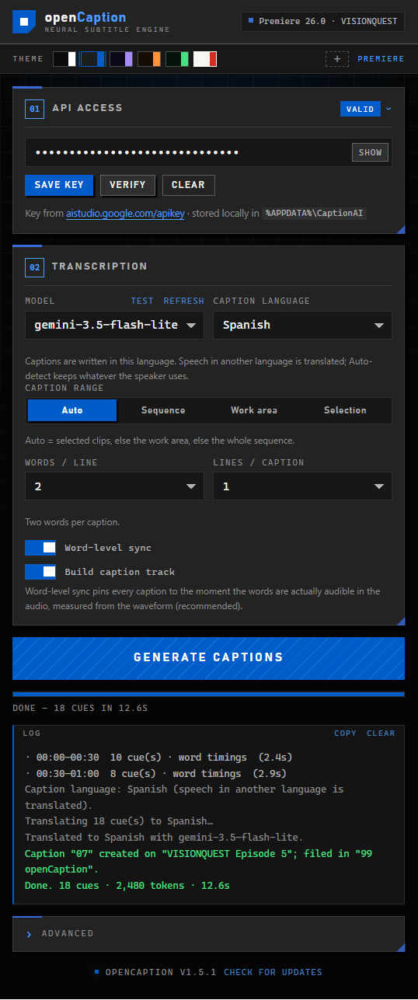
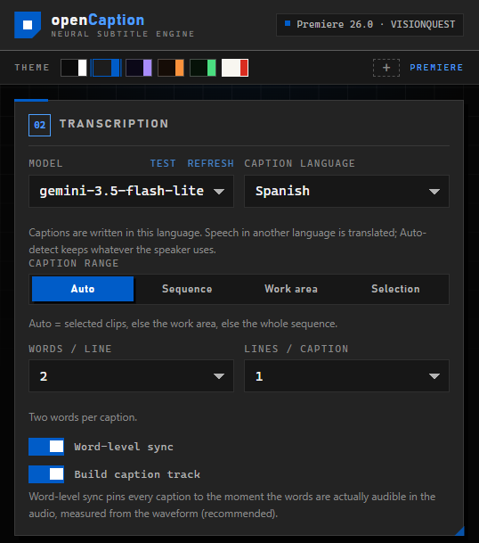
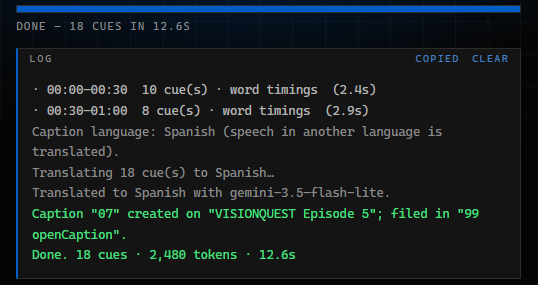
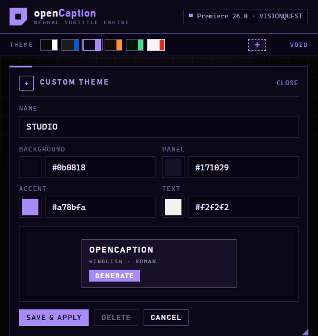
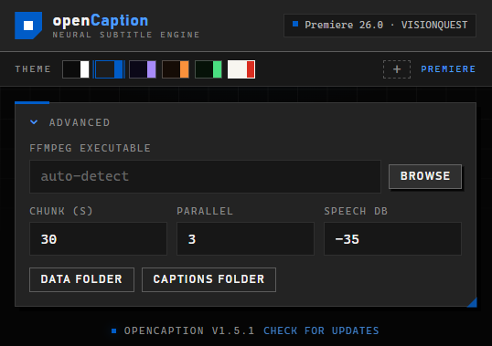
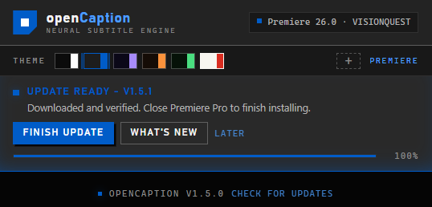

<p align="center">
  
</p>

# openCaption — auto captions for Premiere Pro (Gemini)

A CEP panel for Premiere Pro that transcribes your timeline audio with the Google
Gemini API and drops the result back as a real, editable caption track.

No Media Encoder, no render, no upload of your whole sequence: the panel reads the
timeline structure, slices audio straight out of your **original source media**
with ffmpeg, and sends 30-second windows to Gemini.

**Download:** [latest release](https://github.com/Ns345543/openCaption/releases/latest)
— Windows installer zip (recommended) or the ZXP for extension managers.

```
timeline ──► clip list (ExtendScript)          paths + in/out points + positions
         ──► ffmpeg seeks into source media    30s PCM window, gaps = silence
         ──► Gemini audio transcription        1 request per window
         ──► speech-envelope word alignment    captions pinned to audible speech
         ──► .srt on disk
         ──► sequence.createCaptionTrack()     editable caption track in Premiere
```

## Screenshots



*The whole panel: API key, caption settings, run controls and the live log.
Six themes, hard edges, no rounded corners.*



*Caption language is the output language: pick Spanish and any speech — Hindi,
English, French — is translated into Spanish before the SRT is built.*



*Per-chunk timing, the language pass, then the numbered caption filed in
`99 openCaption`. The log can be copied to the clipboard in one click.*



*Build your own palette — background, panel, accent and text — with a live
preview; it becomes an extra swatch on the theme rail.*



*Advanced: ffmpeg path, chunk length, parallel requests, speech threshold and
the data/captions folders.*



*The panel checks GitHub on launch, downloads the new package, verifies its
SHA-256 and installs it after Premiere closes.*

## Interface

Hard 90° edges throughout, no rounded corners, and six palettes you can switch
from the theme rail above the cards. The choice is saved with your other settings.
Press **+** on the rail to build your own palette: pick a background, panel,
accent and text colour, watch the live preview, then save it as an extra swatch.
Secondary shades, borders and status colours are derived from those four inputs
so every control stays readable. A saved custom theme is stored in
`%APPDATA%\CaptionAI\config.json` too, and can be deleted from the same editor.

| Theme | Look |
|---|---|
| Mono | black & white (default) |
| Premiere | black workspace (#1d1d1d) with Premiere's sky blue (#005cc8) |
| Void | violet and cyan on near-black |
| Ember | amber on charcoal |
| Matrix | phosphor green |
| Paper | light paper with vermilion accents |

## Requirements

| | |
|---|---|
| Premiere Pro | 2022 or newer (built and tested against 2026) |
| OS | Windows 10/11 |
| ffmpeg | bundled in the installer — nothing to install |
| Gemini API key | https://aistudio.google.com/apikey (free tier works) |

Costs are per transcription, billed to your own key. A one-hour sequence is roughly
120 short audio requests.

## Install (what your users do)

Two supported routes, both free and per-user (no admin rights):

**A. Windows installer (simplest)**

1. Download `openCaption-1.5.2-windows.zip` and extract it.
2. Close Premiere Pro.
3. Run `install.bat`.

It copies the panel to `%APPDATA%\Adobe\CEP\extensions\com.captionai.panel`,
enables the CEP setting Premiere needs for a self-signed panel, and leaves your
settings alone. `uninstall.bat` reverses it; `uninstall.bat -Purge` also deletes
the saved API key.

**B. ZXP (any CEP extension manager)**

Install `openCaption-1.5.2.zxp` with Anastasiy's Extension Manager, ZXPInstaller or
Adobe `ExManCmd`. This is a **CEP** panel — a UXP-only installer will report
`manifest.json not found`; use a CEP one instead. The .zxp is signed with a
self-signed certificate, which CEP loads only when `PlayerDebugMode` is on, so if
the panel does not appear afterwards, run `install.bat` once (it enables that
setting) and restart Premiere.

Both packages include `ffmpeg.exe`, the panel and this README's condensed
instructions; the user only supplies a Gemini API key.

> The panel was named "Caption AI" up to 1.1.4. Its internal ids are unchanged —
> extension `com.captionai.panel` and settings in `%APPDATA%\CaptionAI` — so an
> existing install is upgraded in place and keeps the saved key.

## Updates

The panel checks GitHub for a newer release when it opens and shows an
**update available / update now** banner:

- The check uses the public `releases/latest` API at most once every 6 hours and
  caches the answer in `%APPDATA%\CaptionAI\update.json`. Offline launches stay
  quiet; the footer also has a **check for updates** link.
- **Update now** downloads the Windows package from the openCaption GitHub
  release, verifies its SHA-256 checksum, extracts it under
  `%APPDATA%\CaptionAI\updates\`, and starts a small helper.
- The helper waits for Premiere Pro to close, replaces
  `%APPDATA%\Adobe\CEP\extensions\com.captionai.panel`, and relaunches Premiere.
  Files are never replaced while Premiere is running.
- The API key and all settings live in `%APPDATA%\CaptionAI` and are untouched.
- If the panel is installed under `Program Files`, is a developer junction, or
  the release has no checksum, **Update now** opens the release page instead of
  installing automatically.

> **First updater release:** v1.5.0 is the first version that can check for
> updates. Users on 1.4.x must install v1.5.0 once by hand; from then on, newer
> releases appear inside the panel.

## Develop from this folder

```powershell
powershell -ExecutionPolicy Bypass -File .\install.ps1
powershell -ExecutionPolicy Bypass -File .\setup-ffmpeg.ps1
```

`install.ps1` does two things:

1. Junctions `extension\` into `%APPDATA%\Adobe\CEP\extensions\com.captionai.panel`
   (per-user, no admin rights, and edits you make in this folder are live).
2. Sets `PlayerDebugMode=1` for CSXS 9–16 so Premiere loads the unsigned panel.

Then restart Premiere Pro and open **Window → Extensions → openCaption**.

> Running the packaged `install.bat` replaces that junction with a real copy, so
> your edits stop being live. Re-run `.\install.ps1` here to go back to developing.

### Verify the Premiere side first (no API calls)

In Premiere run **File → Scripts → Run Script File…** and pick
`tools\premiere-diagnose.jsx`. It dumps every audio clip the panel would use, the
paths it will read from, skipped clips (no media path / speed changes), offline
media, and whether `createCaptionTrack()` exists on your build. It changes nothing.

## Use

1. Paste your Gemini API key, press **Save key** (it validates against the API).
2. Open the sequence you want captioned.
3. Pick the caption range:
   - **Auto** (default) — selected clips if anything is selected, else the work
     area if it is enabled, else the whole sequence. The log shows what it picked,
     e.g. `Sequence "Edit" · work area — auto`.
   - **Sequence** — everything, from 00:00:00 to the sequence end.
   - **Work area** — the sequence work area / in-out range.
   - **Selection** — only where selected timeline items overlap.
4. Press **Generate captions**. A **Stop** button appears next to it while the run
   is going (or press **Esc**): it hangs up on every open request immediately and
   discards the partial result, so no caption track is created.

**Caption language** is the output language, not a guess about the audio. Pick
**Spanish** and Hindi speech is translated into Spanish before the SRT is built;
the same applies to French, Turkish, Japanese and the rest of the list.
**Auto-detect (spoken language)** keeps whatever is spoken and never translates.
**Hinglish (Roman)** writes Hindi speech in Latin letters
(`aaj hum naya project discuss karenge`), never Devanagari, keeping English words
spelled normally.

A dedicated `*-transcribe` model always answers in the spoken language, and a
general model can ignore the instruction when the scripts differ. In both cases
the panel translates the cues in a second text-only pass before building the SRT.
Cue timings are preserved, and if the translation request fails the original
captions are kept with a warning instead of being lost.

The panel writes `…\CaptionAI\captions\<sequence>_<timestamp>.srt` and, by default,
imports it and calls `createCaptionTrack()` so a captions track appears on the
sequence. Imported SRTs are filed in a bin called **99 openCaption** at the project
root (created on first use), so they never mix into your own bins. Each caption
there is numbered `01`, `02`, `03`… in the order you generate it, and the counter
is per project. On the first run, older SRTs already in the bin are numbered in
bin order; after that, numbered items keep their numbers and the next run
continues after the highest one. Other items and bins are left alone. If
Premiere refuses, the SRT is still on disk — drag it into the Project panel and
onto the sequence.

## Settings that matter

- **Words / line** and **Lines / caption** — the shape of one caption, counted in
  words so it behaves the same for Hinglish and any other language. The defaults
  are **2 words on 1 line** (a short, one-line caption at a time). Raise *lines* to
  2–3 for longer phrases; the panel then balances the lines and breaks on commas
  rather than mid-phrase. A caption never holds more than *words × lines* words —
  longer model output is split into several captions, each pinned to its own speech.
- **Word-level sync** — measures a 10 ms energy envelope over the audio of every
  slice and finds exactly where speech starts and stops. Caption and word edges are
  placed on those measured spans, so a caption appears when the words become
  audible and disappears when they end, instead of following the model's rough
  phrase timestamps. When the selected model returns real word timestamps (see
  *Model*) those measured times win: every word is placed at the moment it is
  spoken, and a pause longer than 0.28 s closes the caption so the break in
  dialogue is a break in the subtitles. Leave this on; with it off the panel falls
  back to plain proportional splitting.
- **Chunk length** — shorter = better timestamp accuracy, more requests. 30s is the
  sweet spot; 10s is noticeably tighter but ~3× the calls.
- **Parallel** — how many chunks are in flight at once (default 3). This is the main
  speed dial: 10 minutes of audio is ~20 chunks, so 3 in parallel finishes in about
  a third of the wall time. Raise it to 5–6 if your quota allows; drop to 1 if you
  start seeing `429` retries in the log.
- **Stop** — available during a run (or **Esc**). In-flight Gemini requests are
  destroyed rather than waited out, and the queue stops immediately, so a stop
  takes effect in well under a second.
- **Speech threshold (dB)** — the level above which the envelope counts as speech.
  Raise toward −25 dB for noisy material, lower toward −45 dB for quiet dialogue
  with music beds.
- **Model** — the panel prefers a *flash-lite* model, which answered a 30-second
  slice in ~2.7 s and a 1.2-second one in ~2 s on a free-tier key. `flash` models
  are slower, and `pro` models are slower still and often have zero free-tier
  quota (`refresh` lists what your key can actually use). Press **test** to time
  text and audio for the selected model before committing to a long sequence.
  Dedicated `*-transcribe` models return a timestamp for **every word** through the
  Interactions API, which makes the pause handling exact. On a free-tier key that
  model is capped at **25 requests/day** (~12 minutes of audio at the 30 s chunk
  length), so use `flash-lite` — whose quota is separate — for long sequences; the
  panel then times the words from the measured waveform. Transcribe models also
  pick the spoken language themselves; the panel translates their output to the
  selected caption language (or rewrites it in Roman Hinglish) in a second pass.

## How the timing is reconstructed

For every 30-second window the panel asks Premiere which clips overlap it, then
renders each clip's slice at the exact offset:

```
clip.start ──► window start ──► clip.end
      │<---- extracted from source: in + (windowStart - clip.start) ---->│
```

The PCM is pasted into a zeroed buffer at `(clip.start - windowStart)`, so sample 0
of the buffer *is* `windowStart` of the sequence. A cue at 4.2s in the response
becomes 4.2s into the window, i.e. sequence time `windowStart + 4.2`. No drift
across clips, no accumulated rounding.

That exact PCM is also what the panel listens to. Before the model's cues are used,
the slice's energy envelope is scanned at 10 ms resolution to find the spans where
sound actually exists. The model's phrase timestamps are only coarse anchors: each
cue's words are spread across the speech spans it overlaps, weighted by syllable
count, and a word is never stretched across a pause. A caption then starts on its
first word's measured onset and ends 120 ms after its last word — no padding, no
minimum duration pushing it into silence. A detected pause longer than 420 ms
always ends the caption. The final pass over the whole sequence only sorts, clamps
and trims overlaps; it never delays a caption to resolve a collision, which is what
used to push later cues behind the speech.

When the model is a dedicated `*-transcribe` one, the panel skips that estimation
and asks the Interactions API for word-level timestamps in the same request
(`timestamp_granularities: ["word"]`). Every word comes back with an exact
`start_offset` / `end_offset`, so a caption is built from real speech times: it
opens on its first word, closes 80 ms after its last word, and the next caption
starts when the speaker resumes. A pause of 0.28 s or more between words is kept
as a gap instead of being filled with a cue. If that request is unavailable (quota,
older key), the panel notes it in the log and falls back to the waveform method
above, so timing is still reconstructed — just from the envelope rather than from
exact word times.

Together this keeps captions locked to the timeline: an imported caption track
switches lines exactly when the speaker does, and gaps in dialogue stay gaps in the
subtitles.

## Known limits

- **Speed-changed clips** — the source span is tempo-matched back to the timeline
  before transcription, so a constant speed change stays in sync. Speed ramps are
  approximated with one factor and can drift slightly.
- **Nested sequences** — skipped with a warning; Premiere exposes them as project
  items without a media path. Flatten or caption the inner sequence instead.
- **Multicam / merged clips** — same story; the underlying file isn't reported.
- **Offline media** — reported per clip and skipped.
- **Muted / disabled audio tracks** — skipped, so you won't caption a scratch track.
- **Overlapping tracks** — where clips overlap, the lower track number wins (A1 before
  A2). Keep dialogue on A1, or mute the tracks you don't want transcribed.
- **Chunk boundaries** — a phrase that straddles a 30s edge can arrive as two cues.
  Raise the chunk length if that bothers you; the text is never lost.
- **Music-only passages** — omitted rather than described.
- **Gemini phrase timestamps are approximate.** With `flash-lite` they are only
  used as anchors; the caption edges come from the measured speech envelope. Inside
  one continuous phrase, word boundaries are estimated from syllable weight, so a
  very fast run of words can still be off by roughly a tenth of a second. A
  `*-transcribe` model avoids this by returning exact word times. A pass in the
  Text panel is still normal practice for broadcast.
- **Translation** — the selected caption language is enforced by the prompt and,
  when the output still uses the source script, by a second text pass. Changing
  language inside the same script (English speech, Spanish captions) relies on the
  model following the instruction; check the first cues before a long run.
- **API key storage** is local obfuscation, not encryption. Anyone with access to
  your Windows account can read `%APPDATA%\CaptionAI\config.json`. That is fine for
  a personal tool; it is why no key is bundled.

## Troubleshooting

**Panel doesn't appear in Window → Extensions**
Re-run `install.ps1`, confirm the junction exists in
`%APPDATA%\Adobe\CEP\extensions\`, confirm `PlayerDebugMode=1` under
`HKCU\Software\Adobe\CSXS.13`, then fully quit and relaunch Premiere.

**"Node.js is not available in this panel"**
The manifest's `--enable-nodejs` / `--mixed-context` flags didn't apply. Re-install
and restart; verify `CSXS/manifest.xml` is being read (not a stale copy).

**"ffmpeg.exe not found"**
Run `setup-ffmpeg.ps1`, or point the panel at any `ffmpeg.exe` under Advanced.

**"Premiere rejected the script"**
`host.jsx` didn't load. Restart Premiere. While debugging, load
`http://localhost:7777` in Chrome and open DevTools for the panel.

**"Could not serialise response: ReferenceError: JSON is undefined"**
ExtendScript on that Premiere build has no native `JSON`. Current packages
bundle `jsx/json2.js` and `host.jsx` loads it automatically. If the panel still
reports this, `jsx/json2.js` was not copied: reinstall the extension and restart
Premiere.

**"No usable audio clips found"**
The range's tracks are muted, the clips are offline, or the clips are nested
sequences. Unmute A1/A2 and check the log for per-clip warnings.

**Caption track not created**
Some builds refuse `createCaptionTrack` for a freshly imported SRT. The file is on
disk; drag it from the Project panel onto the sequence.

**"produced no output" / "no output for 60s"**
The key and the network are fine — the request reached Google and the model never
answered. Reasoning models do this when they spend their whole turn thinking.
The panel already asks for the smallest reasoning level each model
family accepts (and drops the setting if the API rejects it), and it stops the run
instead of timing out once per slice. Press **test** next to Model: it sends a
text probe and then a 1.2-second audio probe. If text answers in ~2 s and audio
does not, switch to a **flash-lite** model — on a free-tier key it answered the
audio probe in ~2 s while `gemini-3.8-flash` took ~100 s.

**Every request retries 429**
You are hitting the free-tier rate limit. Set **Advanced → Parallel** to 1 and
raise the chunk length to 60 s.

## Layout

```
extension/
  CSXS/manifest.xml        panel registration, Node + mixed context
  index.html               panel UI
  css/style.css
  js/nodeglue.js           Node built-ins (fs, https, child_process)
  js/CSInterface.js        minimal CEP bridge
  js/config.js             settings in %APPDATA%\CaptionAI\config.json
  js/premiere.js           async wrapper over ExtendScript
  js/audio.js              ffmpeg slicing, PCM assembly, speech envelope
  js/gemini.js             REST calls, JSON schema, retries
  js/srt.js                word timing, cue clean-up, wrapping, SRT output
  js/roman.js              Devanagari → Roman Hinglish
  js/translate.js          forces the selected caption language
  js/update.js             GitHub release check + verified self-updater
  js/app.js                pipeline + UI
  jsx/host.jsx             ExtendScript: clip scan, SRT import, caption track
  jsx/json2.js             JSON polyfill for ExtendScript (loaded by host.jsx)
  tools/ffmpeg/            ffmpeg.exe lands here
install.ps1                junction + debug mode (development)
setup-ffmpeg.ps1           download ffmpeg
installer/                 the Windows installer shipped to users
  install.ps1              copy + unlock + registry, no admin rights
  install.bat              double-click entry point
  uninstall.bat
  README-FIRST.txt         short instructions for end users
build.ps1                  package a release (ZXP + Windows zip)
docs/screenshots/          panel screenshots used by this README
docs/branding/             icon (SVG + PNG) and the 1280x640 social preview
LICENSE                    MIT, covers the panel
THIRD-PARTY-NOTICES.txt    ffmpeg GPL notice
```

## Development

- The junction means edits to `index.html`/`js/` are picked up by reopening the
  panel; `host.jsx` changes need a Premiere restart.
- `localhost:7777` serves the CEP debugger for the panel.
- `js/*.js` are plain scripts (no bundler). `jsx/host.jsx` must stay ES3 — no
  `let`, arrow functions or `Array.map`.
- `node --check extension/js/*.js` catches syntax errors; `srt.js`, `gemini.js`
  and `audio.js` are testable in isolation with a stubbed `NODE` object.

## Build a release

```powershell
.\build.ps1                 # signed .zxp + Windows installer zip
.\build.ps1 -Version 1.0.1  # stamp a new version into the manifest and panel
.\build.ps1 -SkipSign       # Windows zip only, no ZXP
```

Output lands in `dist\`:

| File | What it is |
|---|---|
| `openCaption-<ver>.zxp` | signed CEP extension, ~37 MB (ffmpeg compresses well) |
| `openCaption-<ver>-windows.zip` | `install.bat` + panel + the .zxp, ~74 MB |
| `SHA256SUMS.txt` | checksums for both |

The build downloads Adobe's `ZXPSignCmd.exe` once into `.build\tools`, creates a
self-signed certificate in `.build\cert` on first run, signs, then verifies the
signature before writing the zip. `.build` and `dist` are gitignored.

Notes:

- The extension id is `com.captionai.panel`; both install routes write to
  `%APPDATA%\Adobe\CEP\extensions\com.captionai.panel`, so they replace each other.
- A self-signed ZXP is what free CEP panels ship with. Some CEP builds still want
  `PlayerDebugMode=1`, which `install.bat` sets (and the ZXP docs mention).
- `ffmpeg.exe` is GPLv3. It is bundled unmodified as a separate executable and
  covered by `THIRD-PARTY-NOTICES.txt`; ship that file with any redistribution, or
  build with `-SkipSign`-style trimming if you prefer users to supply their own.
- An Apple Silicon / Intel Mac build is not packaged: it would need a macOS
  `ffmpeg` binary and `install.command` instead of `install.bat`.
