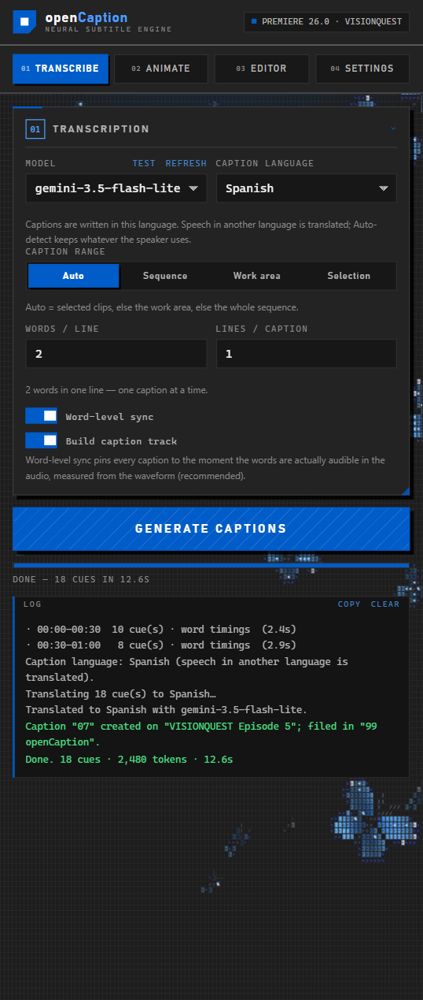
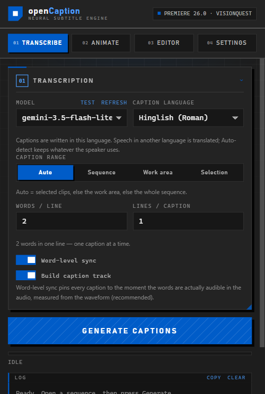
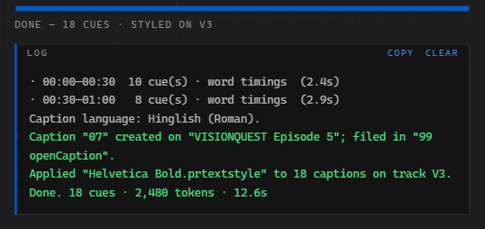
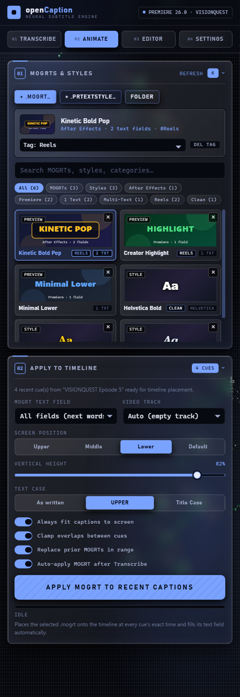
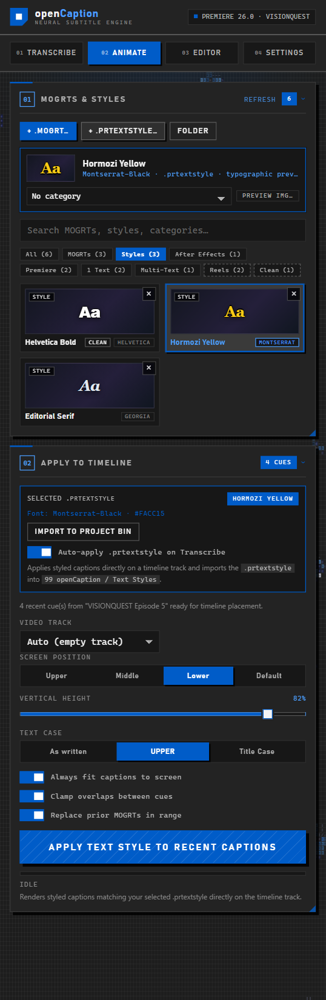
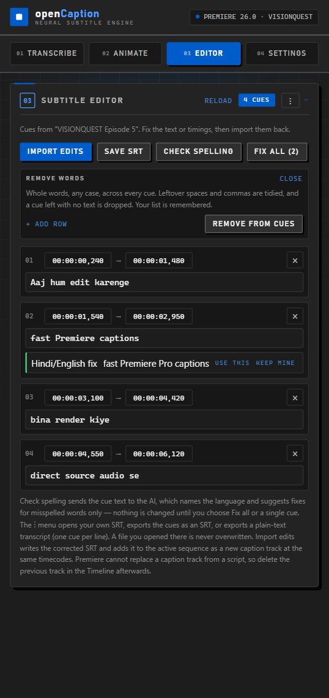
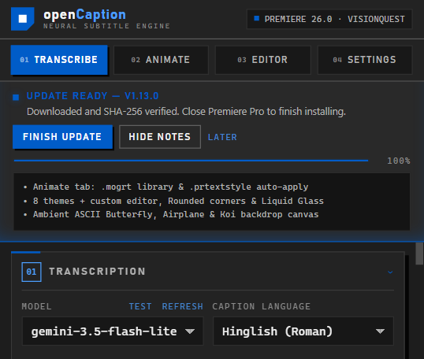
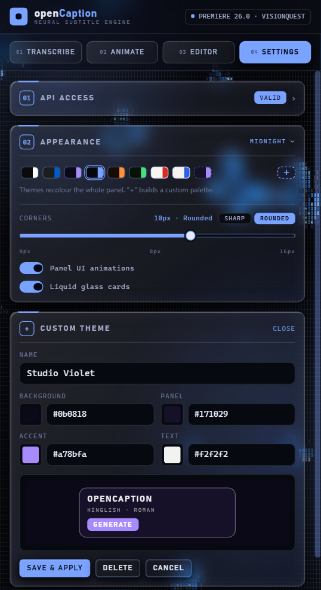
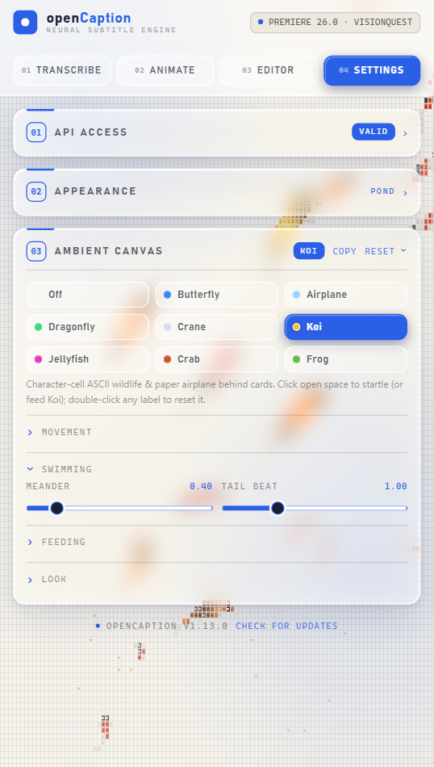
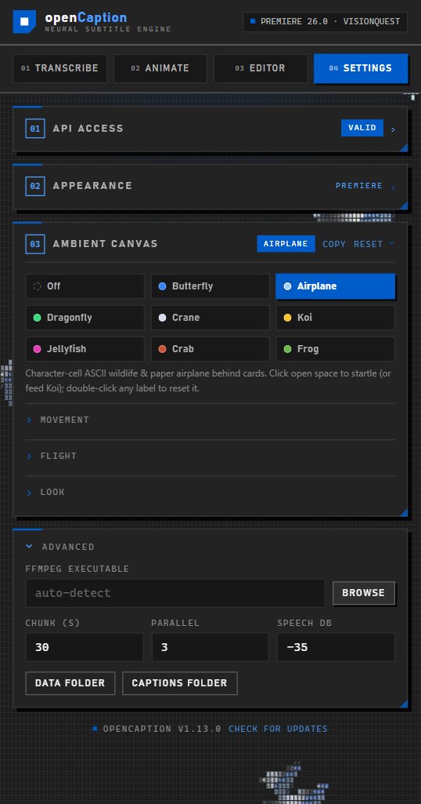

<p align="center">
  
</p>

<h1 align="center">openCaption</h1>

<p align="center">
  <strong>Fast, open-source AI captions, cue editing &amp; animated timeline titles for Adobe Premiere Pro — powered by Google Gemini.</strong>
</p>

<p align="center">
  <a href="https://github.com/Ns345543/openCaption/releases/latest">
    
  </a>
  <a href="https://github.com/Ns345543/openCaption/releases">
    
  </a>
  <a href="LICENSE">
    
  </a>
  
  
</p>

<p align="center">
  <a href="https://github.com/RookieEnough/Orion-Store">
    
  </a>
</p>

<p align="center">
  <a href="https://github.com/Ns345543/openCaption/releases/latest/download/openCaption.zip"><strong>Download Windows Installer (.zip)</strong></a>
  &nbsp;·&nbsp;
  <a href="https://github.com/Ns345543/openCaption/releases/latest/download/openCaption.zxp"><strong>Download Signed Extension (.zxp)</strong></a>
  &nbsp;·&nbsp;
  <a href="https://github.com/RookieEnough/Orion-Store">View on Orion Store</a>
</p>

---

**openCaption** is a native Premiere Pro CEP panel that transcribes your sequence audio via your own Google Gemini API key, snaps every cue to the real speech waveform, lets you polish lines in a built-in subtitle editor, and automatically styles or animates captions on the timeline with **`.mogrt`** templates and **`.prtextstyle`** presets.

No Media Encoder export, no full-sequence render, and no cloud video upload: the panel reads your timeline clips, extracts 30-second PCM windows straight from your **original source media** with `ffmpeg`, transcribes and aligns speech, and builds an editable Premiere caption track or animated graphics track directly on your sequence.

```text
timeline ──► clip list (ExtendScript)          paths + in/out points + timeline positions
         ──► ffmpeg seeks into source media    30s PCM windows, timeline gaps = silence
         ──► Gemini audio transcription        parallel requests, live cancellation
         ──► speech-envelope word alignment    10 ms energy scan + word timestamps
         ──► .srt & sequence.createCaptionTrack()
         ──► Animate tab (optional auto-apply) .mogrt fields & .prtextstyle track styling
```

## Feature Showcase

### 01 · Transcribe & Real-Time Pipeline

Fast transcription, translation, Roman Hinglish output, word-level waveform sync, and per-chunk timing in one compact panel.

<table align="center">
  <tr>
    <td align="center" valign="top" width="33%">
      <br>
      <sub><b>Transcribe Tab &amp; Live Log</b><br>4 tabs, collapsible cards, word-level sync &amp; automatic <code>99 openCaption</code> filing.</sub>
    </td>
    <td align="center" valign="top" width="33%">
      <br>
      <sub><b>Language, Translation &amp; Shape</b><br>15+ languages, Hinglish (Roman), Auto-detect, range modes, and words/lines shaping.</sub>
    </td>
    <td align="center" valign="top" width="33%">
      <br>
      <sub><b>Timeline &amp; Style Placement Log</b><br>Per-chunk timing, one-click log copy, and instant styled track confirmation.</sub>
    </td>
  </tr>
</table>

### 02 · Animate — `.mogrt` Templates & `.prtextstyle` Auto-Apply

Import animated **`.mogrt`** templates (Premiere or After Effects) and native Premiere **`.prtextstyle`** presets. Preview typography or hover animations, organize presets with smart filters and custom `#tags`, and automatically place styled captions onto your timeline after transcription.

<table align="center">
  <tr>
    <td align="center" valign="top" width="50%">
      <br>
      <sub><b>MOGRT Library, Filters &amp; Timeline Placement</b><br>Search &amp; smart filters (<code>MOGRTs</code>, <code>Styles</code>, <code>After Effects</code>, <code>Premiere</code>, custom tags), multi-field splitting, Upper/Middle/Lower/Default positioning, vertical height slider, case transform, auto-fit, and overlap clamping.</sub>
    </td>
    <td align="center" valign="top" width="50%">
      <br>
      <sub><b><code>.prtextstyle</code> Typographic Preview &amp; Auto-Apply</b><br>Reads font, weight, fill &amp; stroke directly from <code>.prtextstyle</code> files (or custom preview images), renders styled timeline captions automatically on Transcribe, and imports styles into <code>99 openCaption / Text Styles</code>.</sub>
    </td>
  </tr>
</table>

### 03 · Editor — Subtitle & Transcript Workbench

Review every cue with live timecode editing, AI spell checking, bulk filler-word removal, find/replace rules, SRT import/export, and plain-text transcript export.

<table align="center">
  <tr>
    <td align="center" valign="top" width="55%">
      <br>
      <sub><b>Subtitle Editor Tab</b><br>Inline timestamps, AI <b>Check spelling</b> (<code>Use this</code> / <code>keep mine</code> / <code>Fix all</code>), persisted <b>Remove words</b> &amp; <b>Replace words</b> rules, <code>.srt</code> / <code>.txt</code> import &amp; export, and one-click <b>Import edits</b>.</sub>
    </td>
    <td align="center" valign="top" width="45%">
      <br>
      <sub><b>SHA-256 Verified In-Panel Updater</b><br>Checks GitHub Releases automatically, streams downloads with retry/cancel, verifies checksums, and updates cleanly when Premiere closes.</sub>
    </td>
  </tr>
</table>

### 04 · Themes, Liquid Glass, Custom Palette & Ambient ASCII Canvas

Customize every inch of the panel: **8 built-in palettes** (including dark **Midnight** and warm ivory **Pond**), custom 4-color palette editor, **Rounded corners** switch, **Liquid glass cards** frosted-blur translucency, collapsible sections across all tabs, responsive compact-width layout, and interactive character-cell **ASCII wildlife & paper airplane** animations behind your cards.

<table align="center">
  <tr>
    <td align="center" valign="top" width="33%">
      <br>
      <sub><b>Themes, Corners &amp; Liquid Glass</b><br>Midnight theme, 10px rounded corners, Liquid Glass frosted cards, and the live Custom Theme builder.</sub>
    </td>
    <td align="center" valign="top" width="33%">
      <br>
      <sub><b>Pond Theme + Swimming ASCII Koi</b><br>Warm ivory palette with Liquid Glass translucency; click open canvas space to startle creatures or drop Koi food pebbles.</sub>
    </td>
    <td align="center" valign="top" width="33%">
      <br>
      <sub><b>Ambient Canvas &amp; Advanced</b><br>8 interactive creatures + Paper Airplane with Movement, Creature &amp; Look tuning sliders, collapsible cards, and ffmpeg/chunk controls.</sub>
    </td>
  </tr>
</table>

---

## Interface Overview

The panel is organized into four clean tabs (and remembers the last tab and collapsed card state you used):

| Tab | What it holds |
|---|---|
| **01 · Transcribe** | Gemini model selector (`test` & `refresh`), 15+ caption/translation languages + **Hinglish (Roman)**, Caption range (`Auto` / `Sequence` / `Work area` / `Selection`), Words / line & Lines / caption, **Word-level sync**, **Build caption track**, **Generate / Stop (`Esc`)**, progress bar, and copyable live log. |
| **02 · Animate** | Unified **`.mogrt` & `.prtextstyle` library**, live typographic/video/motion previews, search + smart/custom category filter chips, multi-field MOGRT mapping (`split` / `pair` / `single`), video track selector (`Auto empty` or `V1`–`V6`), screen position presets (`Upper` / `Middle` / `Lower` / `Default`) + vertical height slider (`8–92%`), text case (`As written` / `UPPER` / `Title Case`), auto-fit & overlap clamping, and **Auto-apply after Transcribe**. |
| **03 · Editor** | Cue-by-cue editor for the latest run or any opened `.srt`. Includes **Check spelling** (`Use this` / `keep mine` / `Fix all`), persisted **Remove words…** & **Replace words…**, **Import SRT…**, **Save SRT**, **Export SRT…**, **Export text…** (`.txt`), and **Import edits** back onto the active sequence. |
| **04 · Settings** | Gemini API access, **Appearance** (8 built-in palettes + custom theme builder, **Rounded corners** on/off, **Panel UI animations**, **Liquid glass cards** frosted blur), **Ambient canvas** (`Off`, `Butterfly`, `Airplane`, `Dragonfly`, `Crane`, `Koi`, `Jellyfish`, `Crab`, `Frog` + tuning controls & JSON Copy/Reset), **Advanced** (`ffmpeg` path, chunk length, parallel requests, speech dB, Data/Captions folders), and in-panel updater. |

| Built-in Theme | Look |
|---|---|
| **Mono** | Pure monochrome black & white (default) |
| **Premiere** | Premiere Pro dark workspace (`#1d1d1d`) with sky blue (`#005cc8`) accents |
| **Void** | Violet and cyan on deep obsidian |
| **Midnight** | ASCII dark blue (`#06070c` / `#7aa2ff`) paired with glowing Backdrop Grid |
| **Ember** | Warm amber on charcoal |
| **Matrix** | Phosphor terminal green |
| **Paper** | Crisp light paper with vermilion accents |
| **Pond** | Warm ivory light workspace (`#f6f3ec`) with cerulean blue accents — pairs cleanly with **Koi** & **Liquid Glass** |

---

## Requirements

| Requirement | Details |
|---|---|
| **Premiere Pro** | 2022 or newer (built and tested against Premiere Pro 2026) |
| **OS** | Windows 10 / 11 |
| **ffmpeg** | Bundled inside the release packages — nothing extra to install |
| **Gemini API key** | Free or paid key from [aistudio.google.com/apikey](https://aistudio.google.com/apikey) |

Costs are billed strictly to your own Gemini API key. A 1-hour sequence uses roughly 120 short 30-second audio requests.

---

## Install

Two free, per-user installation methods (no admin rights required), plus open-source catalog tracking on **Orion Store**:

### Option A — Windows Installer (Simplest)

1. Download **`openCaption.zip`** from the [latest release](https://github.com/Ns345543/openCaption/releases/latest) (also discoverable via **[Orion Store](https://github.com/RookieEnough/Orion-Store)**).
2. Extract the zip and **close Premiere Pro**.
3. Double-click **`install.bat`**.

`install.bat` copies the extension to `%APPDATA%\Adobe\CEP\extensions\com.captionai.panel`, enables CEP's `PlayerDebugMode` for self-signed panels, and preserves your existing settings. Run `uninstall.bat` to remove it (`uninstall.bat -Purge` also clears your saved API key).

### Option B — ZXP Package (Any CEP Extension Manager)

Download **`openCaption.zxp`** and install via Anastasiy's Extension Manager, ZXPInstaller, or Adobe `ExManCmd`.

> **Note:** This is a **CEP** panel (UXP-only installers will look for `manifest.json` and fail). Because the `.zxp` uses a self-signed certificate, if the panel does not appear in **Window → Extensions → openCaption**, run `install.bat` once to enable `PlayerDebugMode` and restart Premiere Pro.

Both packages include `ffmpeg.exe`, third-party notices, and this extension bundle; you only need to add your Gemini API key in **Settings**.

> Upgrades preserve your config seamlessly: internal IDs (`com.captionai.panel` and `%APPDATA%\CaptionAI`) remain compatible across all versions.

---

## In-Panel Auto-Updater

The panel checks `Ns345543/openCaption` on launch (at most once every 6 hours, cached in `%APPDATA%\CaptionAI\update.json`) and surfaces a slim update banner when a newer release exists:

- **Update now** streams `openCaption.zip` into `%APPDATA%\CaptionAI\updates\`, verifies size and **SHA-256 checksum** (`SHA256SUMS.txt` / release digest), retries transient CDN/network failures with jittered backoff, and supports instant **Cancel**.
- When Premiere Pro exits, a lightweight PowerShell helper swaps in the new build (with automatic rollback if the swap fails) while keeping `%APPDATA%\CaptionAI` (API key, themes, MOGRTs, styles, captions, drafts) completely untouched.

---

## Using openCaption

### 1. Transcribe Timeline Audio

1. Open **04 · Settings → API access**, paste your Gemini API key, and click **Save key** (verified automatically).
2. Open your Premiere sequence and switch to **01 · Transcribe**.
3. Pick **Caption range**:
   - **Auto** *(default)* — Selected clips if any are highlighted, else the work area if enabled, else the entire sequence.
   - **Sequence** — From `00:00:00` to sequence end.
   - **Work area** — Only the active work-area / in-out span.
   - **Selection** — Only overlapping selected timeline items.
4. Choose **Caption language** (output language — e.g. pick **Spanish** to translate any spoken language, **Hinglish (Roman)** for Latin-script Hindi, or **Auto-detect** to preserve spoken speech), **Words / line**, and **Lines / caption**.
5. Click **Generate captions** (press **Stop** or **Esc** anytime to abort all in-flight requests cleanly).

Generated `.srt` files are saved to `%APPDATA%\CaptionAI\captions\`, imported into a clean project bin named **`99 openCaption`** (`01`, `02`, `03`…), and added onto your sequence as an editable Premiere caption track.

### 2. Style & Animate Captions (`02 · Animate`)

1. Switch to **02 · Animate** and click **`+ .mogrt…`** or **`+ .prtextstyle…`** to build your reusable preset library (`%APPDATA%\CaptionAI\mogrts` and `%APPDATA%\CaptionAI\styles`).
2. Browse cards with **live hover previews** (`.mogrt` embedded thumbnails/MP4s or simulated text, and live typographic font/fill/stroke tiles for `.prtextstyle` — plus optional custom **`Preview img…`** images).
3. Filter by **Search**, **All / MOGRTs / Styles / After Effects / Premiere / 1 Text / Multi-Text**, or assign **custom `#category` tags**.
4. Configure timeline placement:
   - **Video track**: `Auto (empty track)` or explicit `V1`–`V6`.
   - **Screen position**: `Upper`, `Middle`, `Lower`, template `Default`, and exact **Vertical height (`8–92%`)**.
   - **Text case**: `As written`, `UPPER`, or `Title Case`.
   - **Smart guards**: **Always fit captions to screen**, **Clamp overlaps between cues**, and **Replace prior MOGRTs in range**.
5. Enable **Auto-apply .prtextstyle on Transcribe** (or **Auto-apply MOGRT after Transcribe**) so every new transcription automatically places styled captions onto your timeline, or click **Apply to recent captions** anytime on existing cues!
   - *When a **`.prtextstyle`** is active*: openCaption reads its font, weight, fill, stroke, and shadow, synthesizes a matching Essential Graphics MOGRT cleanly for Premiere, places styled captions on the target video track, and imports the `.prtextstyle` into `99 openCaption / Text Styles`.

### 3. Edit Cues & Transcripts (`03 · Editor`)

Every generated run automatically loads into **03 · Editor** (or click **⋮ → Import SRT…** to open any external `.srt`):

- **Inline cue edits**: Fix text or adjust start/end times (`hh:mm:ss,mmm`, `mm:ss.mmm`, or seconds) with validation guards and persistent draft recovery (`editor.json`).
- **Check spelling**: On-demand AI proofreading tailored to English, Hinglish, Hindi, Spanish, and more — surfaces per-cue **`Use this`** / **`keep mine`** actions and **`Fix all`** without altering timing or translating.
- **Bulk word cleanup (`⋮` menu)**: Remembered whole-word **Remove words…** (e.g. `um`, `uh`, `like`) and **Replace words…** (brand names, Hinglish spellings), automatically tidying stray spacing/punctuation and dropping empty cues.
- **Export & Re-import**: **Save SRT**, **Export SRT…**, **Export text…** (clean `.txt` script), or **Import edits** to add the corrected caption track onto the sequence.

### 4. Customize Look & Ambient ASCII Canvas (`04 · Settings`)

- Pick any of the **8 built-in themes** or click **`+`** to build your own 4-color palette with a live preview.
- Toggle **Rounded corners** (`Sharp` / `Rounded`), **Panel UI animations**, or switch on **Liquid glass cards** for frosted-blur translucency over animated backdrops.
- In **03 · Ambient canvas**, choose between **`Butterfly`**, **`Airplane`**, **`Dragonfly`**, **`Crane`**, **`Koi`**, **`Jellyfish`**, **`Crab`**, **`Frog`**, or **`Off`**:
  - Real-time character-cell ASCII rendering with edge anti-aliasing, iridescence shimmer, sparkle, and diffusing energy trails.
  - Click open background space to **startle creatures** (or **drop food pellets for Koi**!).
  - Expand **Movement**, creature-specific, and **Look** sliders to customize every physics parameter (`Copy` JSON preset / `Reset` defaults, double-click any label to reset individual knobs).

---

## Settings That Matter

- **Words / line** & **Lines / caption** — Word-counted caption shaping (default **2 words on 1 line**). Multi-line phrases break naturally on commas and phrase boundaries without exceeding *words × lines*.
- **Word-level sync** — Scans a 10 ms energy envelope over extracted PCM audio to snap caption edges to real audible speech (`120 ms` tail, closes on >420 ms silences). With `*-transcribe` models, uses exact word-level `start_offset` / `end_offset` timestamps via the Interactions API (closes captions on pauses ≥ 0.28 s).
- **Chunk length** & **Parallel** — 30s windows with 3 concurrent requests by default. Drop **Parallel** to `1` and raise chunk length to `60s` if your free-tier key hits `429` rate limits; adjust **Speech threshold (dB)** toward `-25 dB` for noisy environments or `-45 dB` for quiet dialogue under music.
- **Model** — Prefers `flash-lite` models (~2–3 s per 30 s audio window on free-tier keys); press **test** to benchmark text + 1.2 s audio response times on any selected model before running a full sequence.

---

## How Timing is Reconstructed

```text
clip.start ──► window start ──► clip.end
      │<---- extracted from source: in + (windowStart - clip.start) ---->│
```

Every 30-second window places extracted clip PCM at its exact timeline offset in a zeroed buffer so timeline gaps stay silence and multi-cut timelines never drift. Phrase anchors are aligned against the 10 ms waveform speech envelope (or exact `*-transcribe` word timestamps), preventing silent padding or runaway subtitle collisions.

---

## Known Limits

- **Speed-changed clips** — Constant speed changes stay tempo-matched in sync; variable speed ramps use one factor and can drift slightly.
- **Nested sequences / Multicam / Merged clips / Offline media** — Skipped with per-clip log warnings because Premiere exposes no direct source path.
- **Muted / disabled tracks** — Ignored cleanly; overlapping unmuted tracks prefer lower track numbers (`A1` before `A2`).
- **Caption replacement** — Premiere's ExtendScript API can create caption tracks but cannot modify or delete existing caption tracks in place; delete older caption tracks in Premiere's Timeline/Text panel after **Import edits**.
- **Local key storage** — Gemini API keys are stored locally (XOR obfuscated, not hardware encrypted) in `%APPDATA%\CaptionAI\config.json`.

---

## Troubleshooting

- **Panel missing in Window → Extensions**: Re-run `install.bat` (or `install.ps1` in dev), confirm `PlayerDebugMode=1` for your CSXS version (`HKCU\Software\Adobe\CSXS.*`), and restart Premiere Pro.
- **"ffmpeg.exe not found"**: Use a packaged release, run `setup-ffmpeg.ps1`, or browse to your `ffmpeg.exe` under **Settings → Advanced**.
- **Badge says `invalid` or `not verified`**: Check the Activity Log for the exact API message (`API_KEY_INVALID`, disabled Generative Language API, IP/website key restrictions, or network/quota error).
- **"No usable audio clips found"**: Ensure dialogue tracks are unmuted, media is online, and nested/multicam clips are flattened.
- **"No output for 60s" / Slow reasoning model**: Press **test** next to Model; switch to a `flash-lite` model if audio probes time out on a free-tier quota.
- **Frequent `429` retries**: Set **Settings → Advanced → Parallel** to `1` and **Chunk (s)** to `60`.

---

## Layout

```text
extension/
  CSXS/manifest.xml        CEP panel manifest (Node + mixed context)
  index.html               Tabbed UI structure (Transcribe, Animate, Editor, Settings)
  css/style.css            Responsive HUD CSS, 8 themes, rounded corners & Liquid Glass
  js/nodeglue.js           Node.js built-ins bridge
  js/CSInterface.js        Minimal CEP ExtendScript & dialog bridge
  js/config.js             Persistent settings & migration in %APPDATA%\CaptionAI\config.json
  js/premiere.js           Async ExtendScript wrapper + dynamic host loader
  js/audio.js              ffmpeg extraction, PCM buffer assembly, 10 ms waveform envelope
  js/gemini.js             Gemini REST + Interactions word-timing requests + retries
  js/srt.js                Word-envelope alignment, wrapping, SRT build & parse
  js/mogrt.js              .mogrt & .prtextstyle parser, preview extractor & styled MOGRT builder
  js/animate.js            Animate tab library, filters, categories, previews & timeline placement
  js/editor.js             Editor tab: cues, AI spell check, remove/replace rules, SRT/TXT I/O
  js/ambient.js            Interactive ASCII creature & paper airplane canvas engine
  js/theme.js              8 palettes, custom theme derivation, corners, motion & glass
  js/roman.js              Devanagari → Roman Hinglish pass
  js/translate.js          Target-language translation pass
  js/proofread.js          AI spell-check pass
  js/update.js             GitHub Releases check & SHA-256 verified self-updater
  js/app.js                Pipeline orchestrator & UI wiring
  jsx/host.jsx             ES3 ExtendScript: clip scan, SRT import, caption & MOGRT placement
  jsx/json2.js             ES3 JSON polyfill
  tools/ffmpeg/            Bundled ffmpeg.exe
installer/                 Windows end-user install.bat, install.ps1 & uninstall.bat
tests/updater.test.js      Automated updater download/retry/checksum/cancel test suite
tools/                     premiere-diagnose.jsx timeline diagnostic helper
docs/screenshots/          Updated v1.13.1 plugin screenshots (01..10)
docs/branding/             Vector & raster icons + social preview banner
build.ps1                  Signed .zxp + Windows installer .zip builder
install.ps1                Dev junction + CSXS PlayerDebugMode helper
setup-ffmpeg.ps1           Downloads ffmpeg.exe into extension/tools/ffmpeg
THIRD-PARTY-NOTICES.txt    FFmpeg (GPLv3), json2 (PD), and ascii-animals (Apache-2.0 / MIT) notices
LICENSE                    MIT License
```

---

## Develop & Build

```powershell
# Link extension folder live into Premiere CEP & download ffmpeg
powershell -ExecutionPolicy Bypass -File .\install.ps1
powershell -ExecutionPolicy Bypass -File .\setup-ffmpeg.ps1

# Syntax check scripts & run updater tests
node --check extension/js/*.js
node .\tests\updater.test.js

# Build signed .zxp + openCaption.zip + SHA256SUMS.txt into dist\
powershell -ExecutionPolicy Bypass -File .\build.ps1 -Version 1.13.1
```

- Edits to `index.html`, `css/`, and `js/` take effect by closing and reopening the panel (`localhost:7777` exposes CEP DevTools); edits to `jsx/host.jsx` reload automatically or on Premiere restart and must stay ES3-compatible.

---

## Credits & Third-Party Notices

- **[FFmpeg](https://ffmpeg.org/)** (`www.gyan.dev` essentials build) — GPLv3, bundled unmodified for direct source audio extraction.
- **[ascii-animals-extension](https://github.com/sushilbyte7/ascii-animals-extension)** (Apache-2.0, Copyright 2026 Sushil Kumar) & **[ascii-animals](https://github.com/DesignerStephen1/ascii-animals)** (MIT, Copyright 2026 drewdi) — Inspiration and character-cell ASCII animation & flock simulation logic powering **Midnight**, **Pond**, and **Ambient canvas**.
- **[json2.js](https://github.com/douglascrockford/JSON-js)** (Public Domain) — ExtendScript JSON compatibility.
- **[Orion Store](https://github.com/RookieEnough/Orion-Store)** — Open-source app catalog hosting `openCaption` for easy discovery.

See [THIRD-PARTY-NOTICES.txt](THIRD-PARTY-NOTICES.txt) and [LICENSE](LICENSE) for full license texts.
